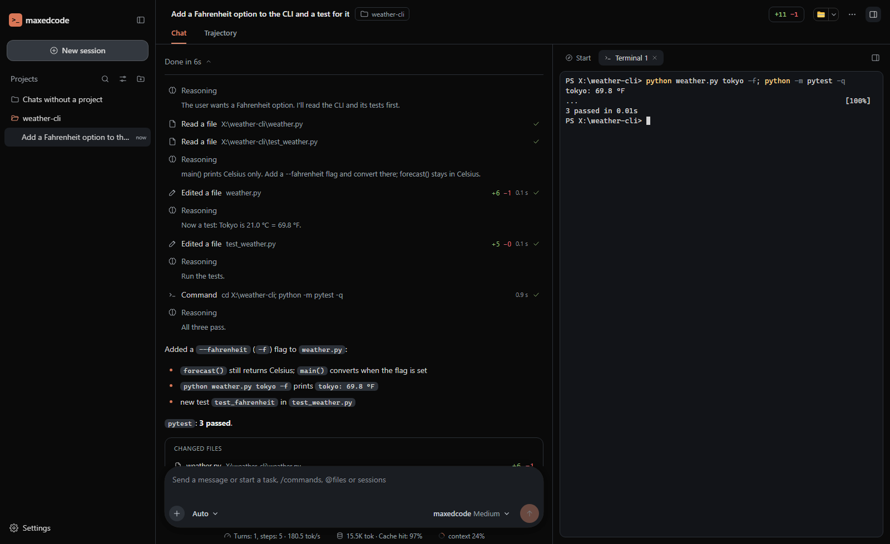
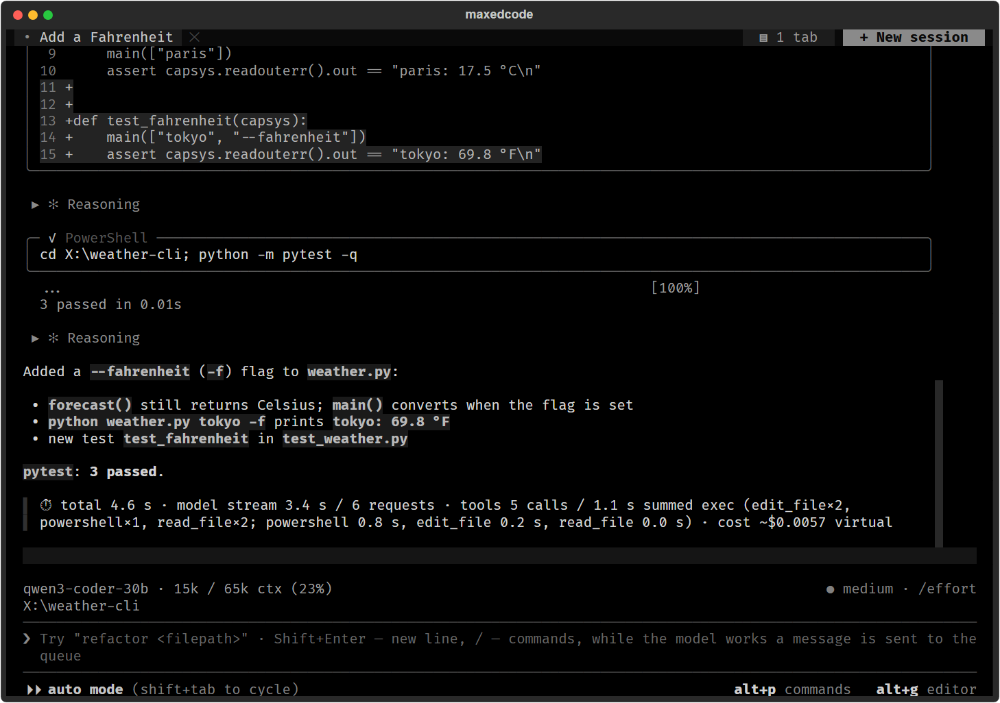
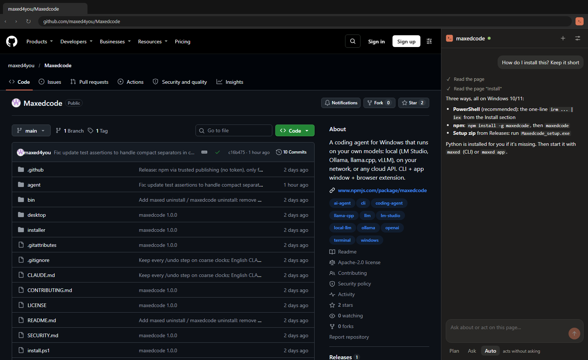

# maxedcode

[](LICENSE)
[](#what-you-need)
[](https://www.npmjs.com/package/maxedcode)
[](https://github.com/maxed4you/Maxedcode/actions/workflows/tests.yml)

A coding agent for Windows (and now Linux and macOS) that runs on **your own models**. It reads and edits your project, runs PowerShell and
Python, searches files and the web, and remembers your chats. Use any model you like: a small one on your own PC or a
big one in the cloud. It works with LM Studio, Ollama, llama.cpp, vLLM, Jan, Strata, a server on another PC in your
network, cloud APIs (OpenAI, Claude, Gemini, DeepSeek, Groq, Mistral, xAI, OpenRouter ...) or any OpenAI-compatible
URL.

You get three things:

- **maxedcode app**: its own window with chats, projects, a real terminal and a browser
- **maxedcode CLI**: the same agent in any terminal (`maxed`), plus `maxed --print "..."` for scripts and CI
- **browser extension**: the agent works in your own Chrome / Edge



| maxedcode CLI | browser extension |
|---|---|
| [](https://raw.githubusercontent.com/maxed4you/Maxedcode/main/.github/assets/cli.png) | [](https://raw.githubusercontent.com/maxed4you/Maxedcode/main/.github/assets/browser.png) |

## Why maxedcode

Most coding agents are tuned for one big cloud model. maxedcode is tuned so that **any** model does good work, and
so that a small local model on a home PC is still useful:

- **Fast on local servers.** The prompt stays byte-identical between requests, so llama.cpp, LM Studio, Ollama and
  vLLM reuse their prompt cache instead of reading the whole conversation again on every step.
- **Small contexts work.** It runs well in a 32k context: compact tool results, a token-budgeted repository map,
  automatic compaction of long chats, and folder docs and rules loaded only when a file is touched.
- **Broken tool calls get fixed.** Malformed JSON, wrong argument names, leaked markup and repeated calls are
  repaired or caught before they waste a step. PowerShell commands are checked before they run.
- **Big models get room.** With a large model and context it plans the work, delegates parts to subagents, checks
  the result with a reviewer and fixes what fails (`ultra` effort).
- **Windows first.** A persistent PowerShell session, CRLF-safe edits, cp1251 / UTF-8 detection, a ConPTY terminal
  in the app, no WSL needed.

Tested with models from small quantized ones (Qwen3 in IQ2/IQ3 on a 32-49k context) up to large ones such as
Qwen 3.8 Flash Next.

### Features

| | |
|---|---|
| **Modes** | Plan, Manual, Accept edits, Auto. Allow / deny / ask rules per tool and command, protected paths |
| **Tools** | read / edit / patch / write files, grep, PowerShell, Python, background tasks, web search and fetch, browser |
| **Undo** | a checkpoint before every edit: `/undo` and rewind to any earlier message |
| **Memory** | `MEMORY.md` files per project and per user, path-scoped rules, `@imports` |
| **Extend** | skills, custom slash commands, subagents, hooks (7 events), MCP servers |
| **Headless** | `--print` with `text`, `json` or `stream-json` output, `--continue`, `--allowed-tools`, `--max-turns` |
| **Cloud help** | `/cloud` asks a cloud model about a task while the project code stays on your PC |

## What you need

- Windows 10 or 11, Linux, or macOS
- A model server: on this PC (LM Studio, Ollama, llama.cpp, Strata ...), on another PC in your network, or a cloud
  API key. It doesn't have to be running while you install.

Python 3.10+ is installed for you if it's missing (Windows: Python 3.12; Linux / macOS: Python 3.12 through
[uv](https://docs.astral.sh/uv/) in `~/.maxedcode/uv`, no sudo).

## Install

**PowerShell** (recommended):

```powershell
irm https://raw.githubusercontent.com/maxed4you/Maxedcode/main/install.ps1 | iex
```

**npm** (if you have Node.js 18+):

```powershell
npm install -g maxedcode
maxedcode
```

The first `maxedcode` sets everything up and asks where your model runs. After `npm update -g maxedcode` the next
start updates the program and keeps your settings. `npx maxedcode` works too.

**Setup zip:** download `Maxedcode_setup.zip` from
[Releases](https://github.com/maxed4you/Maxedcode/releases/latest), extract it and run `Maxedcode_setup.exe`. It's a
short wizard.

All three find Python 3.10+ (or install Python 3.12 for you), look for a model server on this PC, install the app and
the CLI, make the shortcuts and add `maxed` to PATH. Setup never starts a model server for you: if yours isn't
running, its address is saved and maxedcode connects once you start it.

**Linux / macOS:** nothing needs to be installed first, and setup never asks for sudo.

Linux (Ubuntu and Debian come with `wget`, not `curl`):

```sh
wget -qO- https://raw.githubusercontent.com/maxed4you/Maxedcode/main/install.sh | sh
```

macOS (or any system with `curl`):

```sh
curl -fsSL https://raw.githubusercontent.com/maxed4you/Maxedcode/main/install.sh | sh
```

or the same npm package: `npm install -g maxedcode`, then `maxedcode` (it detects the system). In a terminal the
setup wizard asks the install folder (default `~/.local/share/maxedcode`) and the model server; then:

- the program goes to `<folder>/program` with its own Python environment `program/.venv` (the system Python is
  never changed; if it cannot make a venv, as on Debian / Ubuntu without `python3-venv`, setup uses uv and its own
  Python instead)
- `maxed` is linked in `~/.local/bin`; if that folder is not in your PATH yet, setup adds it to your shell's start
  file (`~/.bashrc`, `~/.zshrc` ...) with a marker line that `maxed uninstall` takes out again
- the app: "maxedcode" and "maxedcode CLI" in the app menu (Linux) or `~/Applications/maxedcode.app` (macOS);
  `maxed app` opens its own window (pywebview: Qt on Linux, Cocoa on macOS) or, without it, a tab in your browser

No sudo is needed. `MAXEDCODE_YES=1` installs with the defaults, `MAXEDCODE_ARGS="--dir ~/tools/maxedcode"` passes
installer options.

> **About Windows warnings.** maxedcode has no paid code-signing certificate. The PowerShell and npm installs don't
> trigger SmartScreen. The app window's `.exe` is compiled and signed on your own PC during setup. Only the
> `Maxedcode_setup.exe` from the zip may show "Windows protected your PC": click **More info → Run anyway**. If
> Smart App Control blocks it, use the PowerShell or npm install instead.

<details>
<summary>More install options</summary>

- Wizard through the one-liner: `$env:MAXEDCODE_ASK = "1"` before the command.
- Another server: `$env:MAXEDCODE_ARGS = "--base-url 192.168.0.10:1234 --model qwen3"` before the command (works for
  `install.ps1` and npm).
- The npm setup wizard again: `maxedcode setup`.
- Silent install from the zip: `Maxedcode_setup.exe --yes` (add `--dir`, `--base-url`, `--model`, `--ctx`, `--no-path`,
  `--no-shortcut` as needed).

</details>

## Start

Use the **maxedcode app** or **maxedcode CLI** shortcut (desktop and Start menu), or from any terminal:

| command | what it does |
|---|---|
| `maxed` | the CLI, working in the current folder |
| `maxed app` | the app window |
| `maxed --print "fix the failing test"` | one answer, no UI (`--output-format json` / `stream-json`) |
| `maxed configure` | change the model server or model |
| `maxed shortcuts` | bring back deleted shortcuts |
| `maxed uninstall` | remove maxedcode (`--purge` also removes chats and settings) |

After an npm install, `maxedcode` works the same way as `maxed` (`maxedcode app`, `maxedcode --print ...`). Open a
**new** terminal window after installing, so it sees the updated PATH.

The install folder (`%LOCALAPPDATA%\Programs\maxedcode`) is kept simple:

```
maxedcode app.bat   the app window
maxedcode CLI.bat   the agent in a terminal
README.txt          what is what, how to change the server, the browser extension
program\            everything else
```

Your chats, memory and settings live in `%USERPROFILE%\.maxedcode`. Updating or reinstalling never touches them.

On Linux / macOS the folder (`~/.local/share/maxedcode`) holds `README.txt` and `program/` (with
`program/bin/maxed`, the launcher); the data is in `~/.maxedcode`. `maxed shortcuts` makes the menu entries /
`maxedcode.app` again.

## Model servers

| server | notes |
|---|---|
| LM Studio | load the model with a large enough context (`lms load <model> --context-length 32768`) |
| Ollama | setup offers to raise `OLLAMA_CONTEXT_LENGTH` (the default 4096 is too small) |
| llama.cpp | `-c` is split between `-np` slots: `-c 65536 -np 2` gives each slot 32768 |
| vLLM, Jan | found on this PC by setup; any OpenAI-compatible server works through its URL |
| Strata | `127.0.0.1:8080`; model and context are read at every start |
| another PC | type its address in any form: `192.168.0.10`, `192.168.0.10:1234`, `http://pc:8080/v1` (the port and `/v1` are found); that server must listen on the network |
| cloud | OpenAI, Anthropic (Claude), Google Gemini, DeepSeek, Groq, Mistral, xAI (Grok), OpenRouter, Together AI, Cerebras: pick one and paste your API key |
| anything else | any OpenAI-compatible URL, with or without a key |

Choose or change the server in setup, with `maxed configure`, with `/server` in the CLI, or in the app under
**Settings → Connection**. A 32k context is enough; more is better. The bigger the model, the more you can hand it at
once.

## Safety

maxedcode runs commands and edits files on your PC, so read what it is about to do:

- The app starts in **Plan** mode (read-only). **Manual** asks before every change, **Accept edits** lets file edits
  through and asks before commands, **Auto** runs on its own.
- Even in Auto, irreversible actions are stopped for your OK: download-and-run, force push, discarding uncommitted
  work, recursive deletes outside the project, disk-level operations. Writing to protected paths (`.env`, `.ssh`,
  `AppData`, plus your own `protected_paths`) is refused. Allow / deny / ask rules in `settings.json` tighten this
  further.
- Nothing leaves your PC except the requests to the model server you chose, web search / fetch when the agent uses
  them, and `/cloud` requests you approve (they carry the task, not your code).

Found a security problem? See [SECURITY.md](SECURITY.md).

## Browser extension

Open the app, go to **Settings → Browser**, turn it on, then press **Open the step-by-step guide**. The
guide shows, with screenshots, which folder to load in `chrome://extensions` (Developer mode → Load unpacked).

## Update / uninstall

- **Update:** run the install command again (npm: `npm update -g maxedcode`, then `maxedcode`). Your chats and
  settings stay.
- **Uninstall:** `maxed uninstall` (or `program\bin\uninstall.bat` in the install folder). It removes the program,
  its shortcuts, its PATH entry and the browser bridge, and keeps your chats and settings in `%USERPROFILE%\.maxedcode`;
  `maxed uninstall --purge` removes those too.
- **Installed with npm:** `maxedcode uninstall` does the same and then removes the npm package. (`npm uninstall -g
  maxedcode` alone would leave the program behind: npm runs no uninstall scripts.)

## Run from source

```
git clone https://github.com/maxed4you/Maxedcode
cd Maxedcode
python agent\local_agent.py          # the CLI; asks for the model server on first start
python agent\local_agent.py --app    # the app's server only: prints a link for the browser
python agent\run_all_tests.py        # the test suites
```

| folder | what's inside |
|---|---|
| `agent\` | the agent: `local_agent.py`, the `maxedcode\` package, `install.py` (setup wizard), `tests\` |
| `desktop\` | the app window: C# + WebView2, compiled and signed on the user's PC by setup |
| `installer\` | `build.bat` builds `Maxedcode_setup.zip`; pushing a `v*` tag builds it on GitHub for the release |
| `bin\` | the npm entry point |

Contributions are welcome: see [CONTRIBUTING.md](CONTRIBUTING.md).

## License

[Apache-2.0](LICENSE). The browser extension is based on [OpenSidekick](agent/maxedcode/chrome/extension/LICENSE-OpenSidekick.txt)
(MIT); the WebView2 SDK files are redistributed under [Microsoft's license](desktop/app/lib/LICENSE-WebView2.txt).
